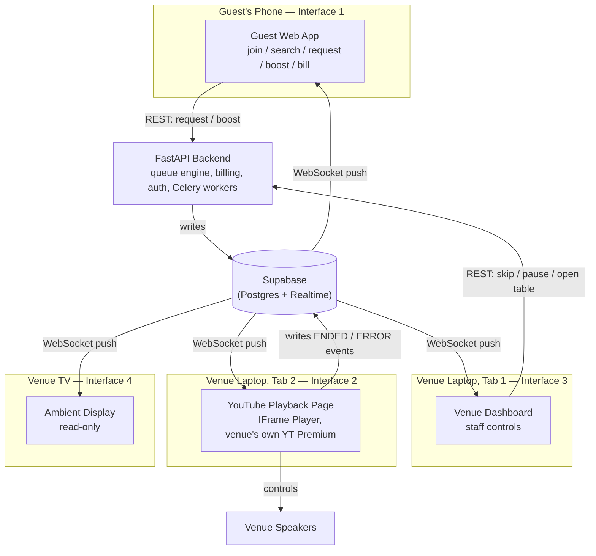

# VibeQueue — The Plan, The Architecture, and Where Things Actually Stand

*Synthesized from: pitch deck (2025), readme.md / frontend_spec.md (June 2026 pilot blueprints), CHANGELOG.md, STATUS.md, TODO.md, AUDIT_REPORT.md — as of 2026-08-23.*

---

## 1. The Simple Version

VibeQueue lets bar guests pay a small amount to move their requested song up a shared queue, visible on a TV in the venue. The venue keeps full control (approved song list, spend caps, a panic button) and takes a cut of the revenue.

The one hard constraint that shaped everything: **VibeQueue is not allowed to be "the thing that plays music to paying customers"** without taking on serious legal and infrastructure weight. So the product was deliberately narrowed to be a **queue manager**, not a music player — whatever already plays music at the venue keeps doing that job; VibeQueue just decides *what's next*.

---

## 2. The Licensing Journey — Why We Are Not "The Player"

### 2.1 The legal fact underneath everything

Playing recorded music commercially in an Indian venue requires two separate licenses:
- **PPL** (Phonographic Performance Limited) — rights to the sound recording itself
- **IPRS** (Indian Performing Right Society) — rights to the composition/lyrics

This is required *regardless of the platform*. A venue's Spotify Premium or YouTube subscription is a personal-use license — it does not cover public commercial playback. This obligation sits with **whoever is playing the music**, not with a queue-ordering tool sitting on top of it. Note (from the pitch deck): as of 2025 this space was in active flux — the Delhi High Court challenged PPL's authority to issue licenses directly in April 2025, with Supreme Court interim relief pending a full hearing. The underlying obligation to be licensed doesn't go away regardless of how that resolves.

### 2.2 Why Spotify was ruled out as the playback engine

- Spotify's developer platform (Web Playback SDK / Connect) is built for **one person, one device, personal listening** — not a commercial venue piping audio to a room of paying customers.
- Running this off a single shared account, hit by staff + many guest sessions every service, looks like automated/high-volume usage from Spotify's side — real risk of the account (and the pilot) getting cut off with no recourse.
- Even if it worked technically, it doesn't solve §2.1 — a Spotify subscription still isn't a commercial public-performance license.

**Verdict: Spotify is not used as the playback engine anywhere in the built system.**

### 2.3 Why "just use YouTube's free API" needed a rethink

There isn't a clean server-to-server API where a backend can say "play song X on that laptop right now." There are actually **two different YouTube APIs**, and they do very different jobs — this is likely the source of the "YouTube free API" memory:

| | **YouTube Data API v3** | **YouTube IFrame Player API** |
|---|---|---|
| Runs where | Server-side (your FastAPI backend) | Client-side, inside a real browser tab |
| Needs an API key? | Yes (free quota tier) | No |
| What it does | Search songs, check if a video is still embeddable, pull metadata | Actually loads and plays a video, fires play/pause/end/error events |
| Used for in VibeQueue | Weekly catalogue re-validation (checking songs haven't been pulled/restricted) | The actual "music playing" mechanism — Interface 2, the Playback Page |

The IFrame Player is what actually makes sound come out of the speakers — and it **only exists inside a visible browser window**. This is why the built system has a dedicated "YouTube Playback Page" tab that must sit open on the venue's laptop, logged into the venue's own YouTube Premium account (Premium removes the ads that would otherwise blast through the PA before every song).

This still doesn't remove the §2.1 licensing obligation — it just means the *venue's own* YouTube Premium subscription is the thing playing the audio, the same way it would if a staff member manually clicked play. VibeQueue's software is only pressing the button on the venue's behalf.

### 2.4 The actual resolution: reposition as queue management only

Rather than VibeQueue taking on the multi-year, capital-intensive process of licensing directly with PPL/IPRS (which is how TouchTunes built its moat over years), the product was scoped down:

- VibeQueue **never streams, hosts, or distributes music**.
- VibeQueue **manages the order** songs play in, and the guest-facing request/boost/billing experience around that.
- **Whatever the venue already plays music through remains their tool and their licensing responsibility** — exactly as required by law with or without VibeQueue.
- This is written as an explicit clause in the pilot agreement (pitch deck §10): *"VibeQueue provides queue management and guest interaction services only. The venue is solely responsible for ensuring all music played through their systems is properly licensed... VibeQueue does not stream, host, or distribute music content."*
- A real IP lawyer review of that clause (₹5,000–15,000) is flagged in the pitch deck as required before any venue signs — **this has not happened yet, per the docs.**
- The pitch deck frames a Phase 2 ambition (12–18 months out) of VibeQueue itself obtaining blanket PPL/IPRS licenses and indemnifying venues — deliberately **not** a pilot requirement.

### 2.5 ⚠️ A discrepancy worth resolving

Two generations of planning docs disagree on *which* playback integration is primary:

| | **Pitch Deck (dated "Bengaluru 2025")** | **readme.md / frontend_spec.md ("Pilot-Ready, June 2026")** |
|---|---|---|
| Primary playback path | **VirtualDJ** — via its open HTTP API, since it's the most common DJ software in mid-tier Bengaluru venues | **YouTube IFrame Player**, run in a browser tab as one of VibeQueue's own four interfaces |
| Fallback for other setups | Dashboard shows "add this song now" alert; staff adds it manually | Same alert pattern, but for *any* non-YouTube setup — VirtualDJ isn't mentioned at all |
| What actually got coded | — | `youtube_service.py` exists in the backend; no VirtualDJ integration exists anywhere in the audited file tree |

The June 2026 docs are more recent and are what the actual build (per AUDIT_REPORT.md, CHANGELOG.md, and your repo's file tree) followed. **Open question for you to resolve:** is VirtualDJ integration still wanted for real venues, or has YouTube-Premium-in-a-browser-tab become the permanent pilot answer? Right now the code only supports the latter, plus manual entry as a catch-all fallback (Dashboard "Mode B").

---

## 3. The Architecture (Technical Depth)

### 3.1 The Four Interfaces

VibeQueue is four separate web pages, all reading/writing the same underlying data, none of which need each other directly:

| # | Interface | Runs on | Used by | Talks to backend how |
|---|---|---|---|---|
| 1 | **Guest Interface** (`/join/[venue]`) | Guest's own phone, mobile data | Every customer | REST calls (join, search, request, boost, bill) + Supabase Realtime subscription |
| 2 | **YouTube Playback Page** (`/playback/[venue]`) | Venue laptop, Tab 2, browser | Nobody — fully automated | Listens for `playback_commands` via Supabase Realtime, writes `playback_events` (ENDED/ERROR/PLAYING) back |
| 3 | **Venue Dashboard** (`/dashboard`) | Venue laptop, Tab 1 | Staff | REST calls (skip, pause, open/close table, flag) + Realtime subscription for alerts/queue |
| 4 | **Ambient Display** (`/display/[venue]`) | TV via Android TV stick | Everyone in the room (passively) | Read-only — Realtime subscription only, zero writes to backend |

### 3.2 Why "Supabase" and "Postgres" are the same setup step

This is important given where you are right now: **Supabase is not a separate thing bolted on top of a Postgres database — Supabase *is* the Postgres database**, plus a real-time layer (`postgres_changes`) sitting on top of the same tables. The FastAPI backend connects to Supabase's Postgres directly as its `DATABASE_URL` and writes to it with SQLAlchemy exactly like any other Postgres instance. Supabase's Realtime engine watches those same table writes and pushes them out over WebSockets to whichever interfaces are subscribed.



So: no separate "link Supabase to Postgres" step exists. Creating a Supabase project *is* creating your Postgres database. What's separate is Redis (Supabase doesn't provide this — Celery's broker and the fast queue-read cache need their own Redis, e.g. Upstash, Railway, or Render).

### 3.3 The Queue Engine

Central scoring formula (documented two slightly different ways across docs — the backend's actual implementation per AUDIT_REPORT.md is authoritative):

```
score = boost_total_paise + (1000 / minutes_since_request)
```

- A ₹15 boost (1500 paise) immediately outranks the time-decay floor (~10 at t=0, decaying to ~33 by 30 min in the readme's simplified version — figures differ slightly between docs, but the *shape* is consistent: boosts dominate, time slowly promotes old unboosted songs so nothing sits forever).
- Ties break on **oldest `requested_at` first** — deterministic, explainable to guests.
- Recalculated on every request/boost/skip/played event; top 8 = "active queue," everything else = "waiting pool." Waiting-pool songs can't be boosted (prevents paying to boost a song that may never even reach the active queue).

### 3.4 Deferred Billing (the trust mechanism)

No charge is ever real until the song actually plays:

1. Guest boosts → row inserted in `boosts` table, status `pending`.
2. Song reaches top of queue → backend writes a `playback_commands` row → Playback Page picks it up → YouTube IFrame loads and plays it.
3. Song finishes → IFrame fires `ENDED` → Playback Page writes to `playback_events` → backend flips the boost from `pending` → `confirmed`.
4. At bill time, guest sees confirmed (charged) vs. still-pending (removable) items before anything hits the food bill.

This is enforced structurally (the ENDED event is the only thing that flips a charge to real), not just as a stated policy.

### 3.5 Anti-Abuse Layers

Approved song pool (structural, not moderated) → per-table request cooldown → hard per-table spend cap → physical table code (rotates every 90 min, proves presence) → visible table attribution (social accountability) → one-tap silent remove for staff → automatic cooldown after repeated flags.

---

## 4. Current Implementation Status — Mapped Against the Plan

### 4.1 The headline truth

**The backend and frontend are both "code-complete" per your own audit report — but the system has never run end-to-end.** Nothing is wired to a live database, a live Redis, a live Supabase project, live Razorpay keys, or a real YouTube Premium account yet. This matches exactly what you said: no Postgres, no Supabase link. Everything below is "written and builds cleanly" vs. "has ever actually executed against real data" — those are two very different bars, and right now you've cleared the first, not the second.

### 4.2 Backend — FastAPI (per AUDIT_REPORT.md)

| Layer | Status |
|---|---|
| 13 API route modules (auth, sessions, queue, boosts, billing, payments, playback, songs, catalogue, venues, analytics, health, websockets) | Written |
| 12 service modules (queue engine, billing, boost, playback, payment, auth, session, venue, catalogue, YouTube, notifications, analytics) | Written |
| 11 ORM models, 9 repositories, Pydantic schemas | Written |
| Celery workers + Beat scheduler (playback watchdog, payment reconciliation, weekly catalogue re-validation, cleanup, analytics, notifications) | Written |
| Docker/Docker Compose (dev + prod) + Nginx | Written |
| Alembic migrations (`alembic/versions/`) | **Empty — no schema has ever been generated or applied to any database** |
| `.env.development` | **Empty — no `DATABASE_URL`, `REDIS_URL`, `RAZORPAY_KEY_ID/SECRET`, `YOUTUBE_API_KEY`, or `JWT_SECRET_KEY` set anywhere** |

### 4.3 Frontend — Next.js 16 (per CHANGELOG.md / STATUS.md, this session)

All four interfaces are built: Guest join/queue/boost/billing screens, Venue Dashboard (login, 6 zones, table management), YouTube Playback Page (IFrame integration, tab keep-alive via silent Web Audio API, event reporting), Ambient Display (read-only, TV-optimized). Zustand stores, a typed REST API client, and Supabase Realtime subscription helpers are all written. **Production build passes with zero TypeScript errors** — but this only proves the code compiles, not that it has ever talked to a real backend or a real Supabase project. `NEXT_PUBLIC_SUPABASE_URL` / `NEXT_PUBLIC_SUPABASE_ANON_KEY` are still placeholders.

### 4.4 What's explicitly flagged as missing before pilot go-live (from AUDIT_REPORT.md)

**Blocking (must happen before anything can run):**
- Alembic migrations never generated/applied
- No Supabase project created; RLS policies not configured
- All production secrets/env vars empty
- PWA icons (`icon-192.png`, `icon-512.png`) referenced in the manifest but don't exist

**High priority, once live:**
- No end-to-end integration test has ever been run (join → request → boost → play → bill)
- No test with a real YouTube Premium account
- No Razorpay test-payment cycle run
- Framer Motion is installed but the queue-reorder animation is **not wired** — this is called out in the audit as *"the product's most important social feature"* (every phone in the room animating simultaneously when a boost lands) and it currently doesn't exist visually
- No error boundaries — an unhandled component error currently crashes the whole page
- Auth isn't persisted across a refresh (JWT held in memory only) — flagged as acceptable for a single-evening pilot, worth fixing before scaling

**Not yet started (business/legal side):**
- No IP lawyer has reviewed the licensing disclaimer clause
- No pilot venues have been locked in against the selection criteria in the pitch deck
- The VirtualDJ-vs-YouTube-only question (§2.5) hasn't been formally resolved

---

## 5. Recommended Path Forward

Ordered so each step actually unblocks the next one — starting from exactly where you are (nothing connected).

### Phase 0 — Prove it locally first (no cloud accounts needed yet)
1. Use the existing local `docker-compose.yml` to spin up Postgres + Redis on your machine.
2. Fill `backend/.env.development` with local values, a throwaway `JWT_SECRET_KEY`, a free `YOUTUBE_API_KEY` (Google Cloud Console → enable YouTube Data API v3, no billing required for the free quota), and Razorpay **test-mode** keys (free to generate).
3. Run `alembic revision --autogenerate` then `alembic upgrade head` against local Postgres — this is the very first missing piece, and it's the one you specifically flagged.
4. Run the existing `seed_db.py` / `seed_catalogue.py` / `create_venue.py` scripts (they already exist in `backend/scripts/`) to get one test venue and a small song catalogue into the database.
5. Start the backend locally, hit `/health` and a couple of real endpoints manually to confirm the whole stack boots.

### Phase 1 — Stand up the real Supabase project
6. Create a Supabase project (free tier is fine for a two-venue pilot).
7. Point `DATABASE_URL` at Supabase's own Postgres connection string instead of local — re-run the same Alembic migrations against it. (No separate "connect Supabase to Postgres" step — this *is* that step.)
8. In the Supabase dashboard, enable Realtime (`postgres_changes`) specifically on: `queue`, `sessions`, `boosts`, `playback_commands`, `playback_events`, `alerts`.
9. Set Row Level Security policies — start permissive for the pilot (you can tighten later), enough that the anon key used by guest/ambient-display clients can actually read.
10. Fill `NEXT_PUBLIC_SUPABASE_URL` / `NEXT_PUBLIC_SUPABASE_ANON_KEY` in the frontend.

### Phase 2 — Wire the remaining third parties
11. **Redis** — Supabase doesn't provide this; get a small instance (Upstash, Railway, Render) for Celery's broker + the queue read-cache.
12. **Razorpay** — confirm test key → sandbox UPI/card payment → webhook round-trip actually completes.
13. **YouTube** — confirm the Data API key works for catalogue validation; separately, get a real YouTube Premium account for the pilot venue's browser session (this has nothing to do with the API key — it's a normal consumer subscription).
14. Deploy the backend (Railway/Render, per your own stack notes — it needs a persistent process for Celery + Beat, so a serverless-only host won't work) and the frontend to Vercel.

### Phase 3 — First real end-to-end run
15. Walk the full loop yourself: open a table on the Dashboard → join as a guest on your phone → search and request a song → boost it → watch it reorder live on all four interfaces → let it actually play through the Playback Page (real browser tab, real YouTube Premium login) → confirm the boost flips pending → confirmed on `ENDED` → close the table → confirm the billing screen appears and totals correctly.

### Phase 4 — Polish before a real Friday night
16. Wire the Framer Motion queue-reorder animation — flagged repeatedly as the single most important social/visual feature and currently missing.
17. Add error boundaries so one bad render doesn't take down a screen during service.
18. Generate the two missing PWA icons.
19. **Resolve §2.5** — decide, in writing, whether VirtualDJ integration is still in scope or whether YouTube-in-a-browser-tab + manual entry is the permanent answer.
20. Get the licensing clause reviewed by an actual lawyer before any venue signs anything.
21. Lock in two venues against the selection criteria table in the pitch deck (avg. age <32, curated music, 90+ min dwell time, owner says "vibe" unprompted, existing QR touchpoint, 70%+ Fri/Sat occupancy) and run the 20-minute setup checklist per venue.

---

## 6. Open Questions Worth Answering Before You Go Further

1. **VirtualDJ or YouTube-only?** (§2.5) — the two planning docs disagree and only one path is actually coded.
2. **Redis hosting** — not addressed in any doc; needs a decision.
3. **Deployment target for the backend** — readme.md says Vercel/Supabase throughout, but the backend is FastAPI + Celery, which needs a long-running process (Vercel serverless can't run Celery workers). The audit report's own tech stack notes point to Railway/Render instead — worth confirming which one you're actually going with, since it changes several config steps above.
4. **IP lawyer review** — not yet done; cheap relative to the risk it removes.